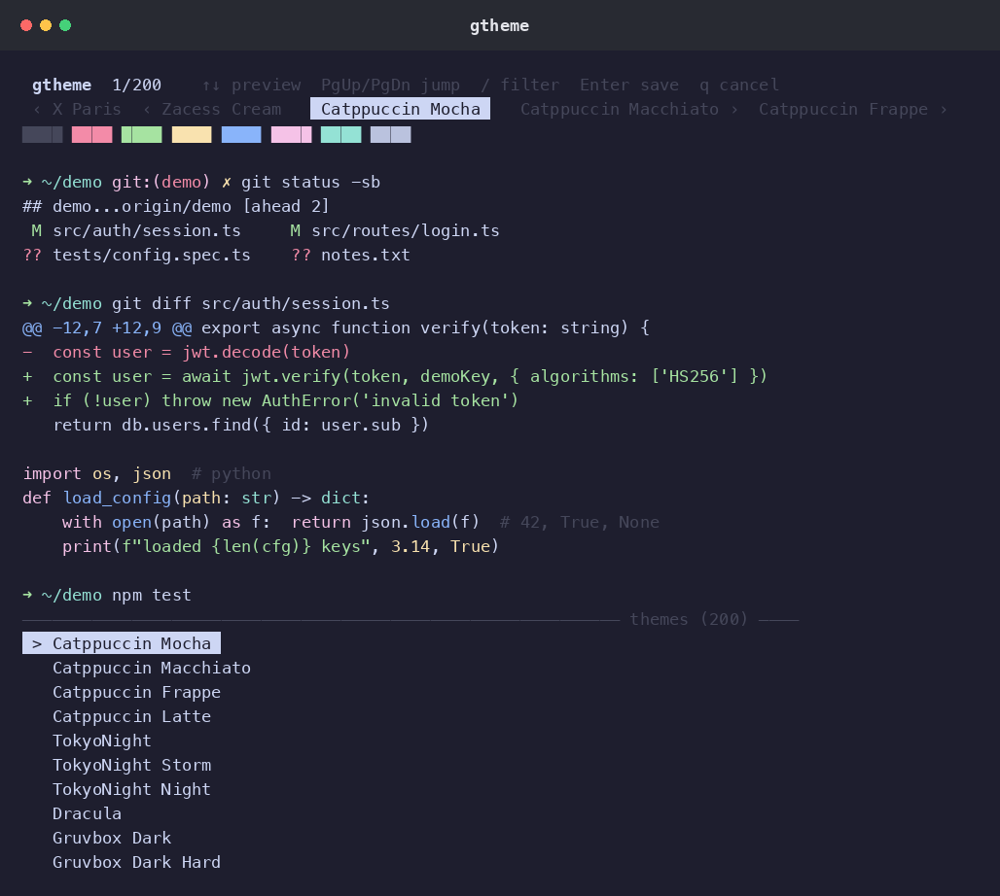
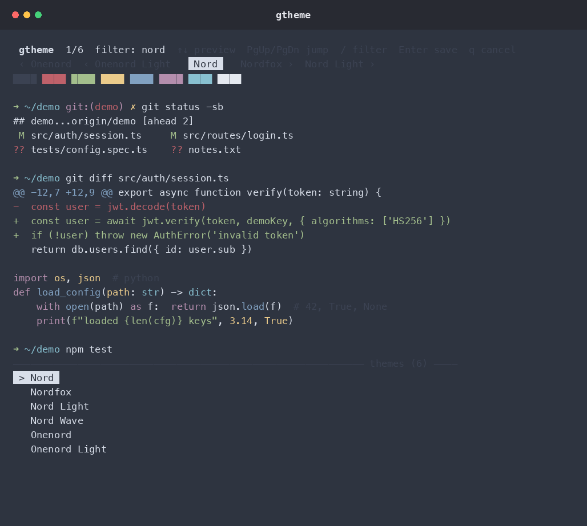

# ghosttytheme | Live Ghostty theme picker for macOS

ghosttytheme lets you preview and change Ghostty themes on macOS with your keyboard. Filter bundled or custom themes by name and see how they color a sample prompt, diff, code, and ANSI palette before you save.

[Project site](https://hypercryptoman.github.io/gtheme/) · [Top 50 Ghostty themes](https://hypercryptoman.github.io/gtheme/ghostty-themes/)

## Install

Requires Ghostty on macOS and Python 3.8 or newer.

```sh
pip install ghosttytheme
ghosttytheme
```

If your Python reports an externally managed environment, use a virtual environment or run `pipx install ghosttytheme`. The package also provides the original `gtheme` command.

Update with `pip install --upgrade ghosttytheme` or `pipx upgrade ghosttytheme`, depending on how you installed it.

## Use

```sh
ghosttytheme
```

Press Tab to cycle through All, Top 50, Dark, and Light. Search with `/` inside any list. You can also open a list directly.

```sh
ghosttytheme --top
ghosttytheme --dark
ghosttytheme --light
```

Top 50 follows the gallery’s curated order and shows themes available in your installation. Dark and Light classify installed themes by their background color, including custom themes with a defined background.

| Key | Action |
| --- | --- |
| ↑ / ↓ or `k` / `j` | Move one theme and preview it |
| Tab / Shift+Tab | Switch to the next or previous list |
| Page Up / Page Down | Jump up or down by ten themes |
| `/` | Start a case-insensitive name filter |
| Backspace | Remove a character while editing the filter |
| Enter while filtering | Finish typing and keep the filtered results |
| Esc while filtering | Clear the filter and stay in the current list |
| Enter while browsing | Save the highlighted theme |
| `q` or Esc while browsing | Cancel and restore the previous colors |
| Ctrl+C | Cancel from either mode |

Saving writes one `theme` value to your Ghostty config and prints the file it updated. If you use an automatic light/dark pair, saving replaces the pair in that file. The picker checks both the macOS Application Support and XDG config directories, including legacy files named `config`. With no existing config, it uses the macOS Application Support directory. It requests a reload from the Ghostty instance running the terminal when it can verify support for the reload signal.

### Command-line options

| Option | Purpose |
| --- | --- |
| `-h`, `--help` | Show usage and exit |
| `--config PATH` | Edit a specific config file, such as a file loaded through a `config-file` directive. |
| `--themes-dir PATH` | Browse only this directory. The picker saves the selected theme as an absolute path so Ghostty can find it. |
| `--top`, `--dark`, `--light` | Open the picker in the chosen list |
| `--no-reload` | Write the config and leave reloading to you. |

### Examples

- **Compare Catppuccin variants.** Run `ghosttytheme`, press `/`, type `catppuccin`, and press Enter. Use ↑ and ↓ to compare results. Press Enter again to save the highlighted variant.
- **Try Dracula and keep your current theme.** Press `/`, type `dracula`, and press Enter to leave the filter. Press `q` to exit with your config untouched.
- **Use a Ghostty installation in your home folder.** Run `ghosttytheme --themes-dir "$HOME/Applications/Ghostty.app/Contents/Resources/ghostty/themes"`.
- **Use an alternate Ghostty config.** Run `ghosttytheme --config "$HOME/Library/Application Support/com.mitchellh.ghostty/config"` if that’s the file Ghostty reads.

## Troubleshooting

- **`ghosttytheme: command not found`.** If you installed it in a virtual environment, activate that environment first. For a pipx install, run `pipx ensurepath` and open a new Ghostty tab.
- **No themes found or colors don’t preview.** Run the picker directly in Ghostty on your Mac. A remote shell or terminal multiplexer can block the escape sequences used for previews. The picker looks in the app bundle and in `$XDG_CONFIG_HOME/ghostty/themes` (or `~/.config/ghostty/themes`). If Ghostty is installed elsewhere, pass its theme directory with `--themes-dir`.
- **The saved theme doesn’t take effect.** Press Cmd+Shift+, or use Ghostty’s Reload Configuration command. Check the config path printed by `ghosttytheme`. An included config file, a launch argument, or explicit color settings can override the chosen theme. Use `--config` to target the file that sets the effective theme. Use `--no-reload` when testing or editing a separate config. [Ghostty configuration guide](https://ghostty.org/docs/config)
- **A custom theme can’t be selected.** Use a readable Ghostty theme file with color settings such as `background = #1e1e2e`. If the picker reports a filename problem, remove commas, colons, equal signs, and double quotes from its filename or the absolute path used with `--themes-dir`.

## Screenshots

The picker displays sample terminal output to show how each theme colors text.

**Browsing themes with Catppuccin Mocha highlighted**



**Filtering by `nord` with Nord highlighted**


